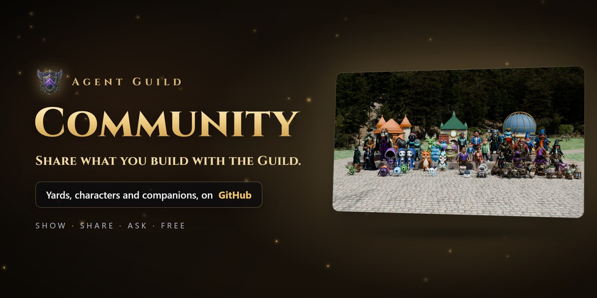

  

  <a href="https://github.com/oddessentials/agent-guild-community/discussions/categories/yards"><b>Yards</b></a> ·
  <a href="https://github.com/oddessentials/agent-guild-community/discussions/categories/themes"><b>Themes</b></a> ·
  <a href="https://github.com/oddessentials/agent-guild-community/discussions/categories/characters"><b>Characters</b></a> ·
  <a href="https://github.com/oddessentials/agent-guild-community/discussions/categories/companions"><b>Companions</b></a> ·
  <a href="https://github.com/oddessentials/agent-guild-community/discussions/categories/help"><b>Help</b></a> ·
  <a href="https://github.com/oddessentials/agent-guild-community/discussions/categories/ideas"><b>Ideas</b></a>

The home of everything people make for [Agent Guild](https://agentguild.oddessentials.ai): Yards built with
[Agent Guild: Builders](https://github.com/oddessentials/agent-guild-builders), characters and companions, and
the people who make them. Browse, download, ask, and share your own.

**Start with:** the [Pixel Office](https://github.com/oddessentials/agent-guild-community/discussions/11) and
[Emberwood Glade](https://github.com/oddessentials/agent-guild-community/discussions/9) themes, and the
[Coral Cove](https://github.com/oddessentials/agent-guild-community/discussions/13),
[Neon City](https://github.com/oddessentials/agent-guild-community/discussions/14) and
[Bonfire Lagoon](https://github.com/oddessentials/agent-guild-community/discussions/12) Yards.

**New to Agent Guild?** [Try the Yard in your browser](https://oddessentials.github.io/agent-guild/?view=yard): nothing
to install. Then get it free for Windows, macOS and Linux at [agentguild.oddessentials.ai](https://agentguild.oddessentials.ai).

## Use a Yard

1. Open a post in **Yards** and download its file. Unzip it to get the `.agworld` file.
2. In Agent Guild, open the Yard and press **Customize this Yard**.
3. Press **Replace** beside **World** and choose the `.agworld` file. **Restore original** puts the old one back.

## Use a character or companion

- **Agent Guild:** **Customize this Yard**, then **Replace** beside the crew or **Companions**, and choose the unzipped folder.
- **Agent Guild: World:** subscribe on the [Steam Workshop](https://steamcommunity.com/app/5462970/workshop/), or use **Add a piece from a folder…**
- **Grove Companion:** **Add character…** from its menu, and choose the unzipped folder.

Yards and pieces hold only models, pictures and settings, never code, and each app checks every file before using it.

## Share yours

1. **Yards:** in Builders, use **Export world…**, then zip the `.agworld` file.
   **Characters and companions:** zip the piece folder.
2. Start a post in [Yards](https://github.com/oddessentials/agent-guild-community/discussions/new?category=yards), [Themes](https://github.com/oddessentials/agent-guild-community/discussions/new?category=themes),
   [Characters](https://github.com/oddessentials/agent-guild-community/discussions/new?category=characters) or [Companions](https://github.com/oddessentials/agent-guild-community/discussions/new?category=companions).
3. Fill in the form, drag in a screenshot and your `.zip`, and post. Bigger than 25 MB? Attach it to a release in a
   repository of your own and paste the link.

Standout work is marked **⭐ Featured** and may appear on [agentguild.oddessentials.ai](https://agentguild.oddessentials.ai).

## House rules

Share only what you made or have the right to share, and be kind. See the [code of conduct](CODE_OF_CONDUCT.md).
Something wrong with a post? Use **Report content** on it.

Bugs in the apps go to their own repositories, starting with [agent-guild](https://github.com/oddessentials/agent-guild/issues).
